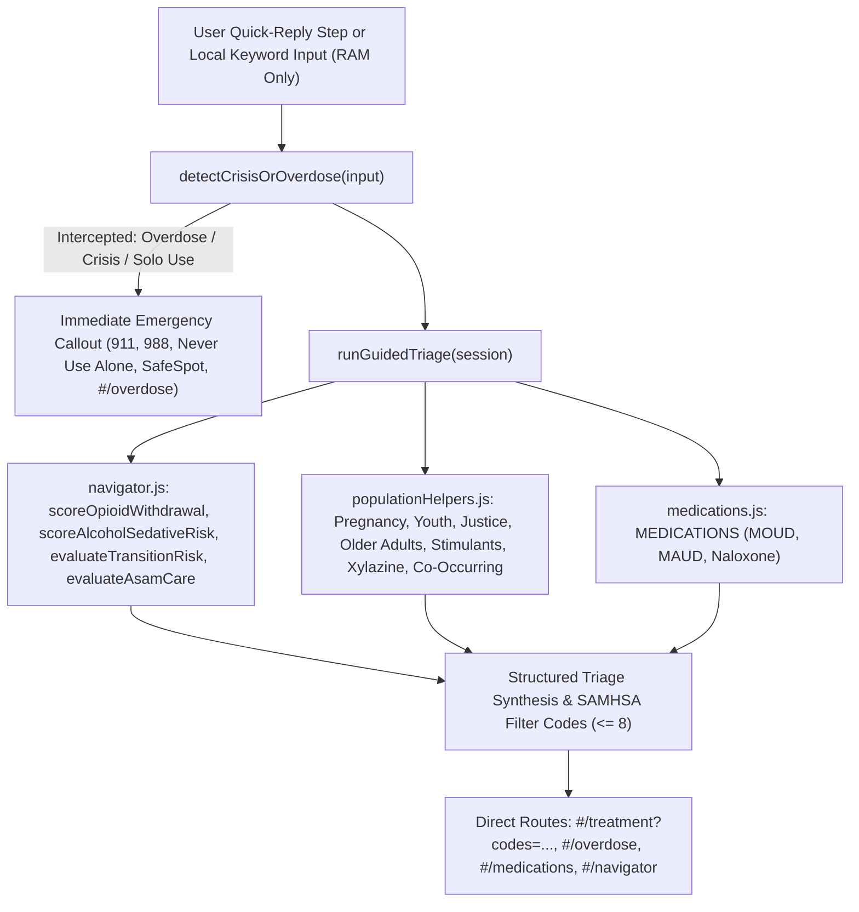

# Privacy-First Guided & Conversational Navigator Spec for HarborPath

## Goal
Make HarborPath’s clinical and harm-reduction tools accessible to more individuals through a step-by-step and conversational guided navigator (`public/js/views/guidedNavigator.js`) that routes people to real treatment providers, withdrawal safety guidance, evidence-based medications, and 24/7 crisis lines while preserving every HarborPath privacy guarantee.

## Non-Negotiable Constraints & Invariants
- **Strict CSP (`default-src 'self'`)**: Zero third-party origins, zero external LLM APIs, and zero network calls from the guided navigator.
- **100% Client-Side Deterministic Triage**: All free-text keyword analysis, symptom scoring, and ASAM level-of-care synthesis run deterministically in browser RAM by composing existing pure functions.
- **No Persistent Storage or Transmission of Inputs**: Nothing typed or selected in `guidedNavigator.js` is sent to any server or written to `localStorage`, `sessionStorage`, `indexedDB`, or cookies.
- **Location Privacy**: Any transition to `#/treatment` uses HarborPath’s existing coarsened (~1 km) location privacy model and strips query parameters from the visible URL bar.
- **Clear Clinical Framing**: Every view and triage result states:
  > *"This is not medical advice, a diagnosis, or an emergency service. Everything you select or type stays in your browser’s memory and is never sent to any server."*
- **Not a HIPAA Covered Entity or 42 CFR Part 2 Program**: Honest, plain-language consumer health privacy framing with zero banned overclaims.

---

## Implemented Architecture (`public/js/views/guidedNavigator.js`)

Rather than relying on external or probabilistic language models that could hallucinate clinical advice or leak sensitive health inputs, HarborPath’s MVP Guided Navigator is implemented as a **100% client-side deterministic clinical composition engine** in `public/js/views/guidedNavigator.js`.



### Exported API in `public/js/views/guidedNavigator.js`

1. **`detectCrisisOrOverdose(input = '')`**
   - Deterministic red-flag interceptor that inspects a string or structured input object (`{ text, freeText, flags, overdose, crisis, usingAlone, mentalHealth }`).
   - **Overdose / Unresponsive Emergency** (`category: 'overdose'`, `severity: 'critical'`):
     - Triggered by keywords (`overdose`, `not breathing`, `slow breathing`, `blue lips`, `unresponsive`, `won't wake up`, `fentanyl poisoning`, `narcan now`, `naloxone now`, `sobredosis`, `no respira`) or `flags: ['overdose']`.
     - Immediately surfaces actions for **Call 911 Immediately** (`tel:911`), **Open Step-by-Step Overdose & 2-Minute Naloxone Timer** (`#/overdose`), **Never Use Alone (`877-696-1996`)**, and **SafeSpot Overdose Prevention Line (`800-972-0590`)**, plus SAMHSA code `['NOE']`.
   - **Suicide / Self-Harm / Acute Mental Health Crisis** (`category: 'crisis'`, `severity: 'critical'`):
     - Triggered by keywords (`suicide`, `suicidal`, `kill myself`, `end my life`, `self-harm`, `hurt myself`, `want to die`, `unsafe with myself`, `suicidio`, `hacerme daño`) or `mentalHealth: 'severe_crisis'`.
     - Immediately surfaces **Call or Text 988 Suicide & Crisis Lifeline** (`tel:988`), **Call 911** (`tel:911`), **SAMHSA National Helpline (`1-800-662-4357`)**, and **View All 24/7 Crisis & Community Lines** (`#/crisis`), plus SAMHSA codes `['WI', 'PEOFF', 'MHSU']`.
   - **Solo Use / Overdose Prevention** (`category: 'solo_use'`, `severity: 'high'`):
     - Triggered by keywords (`using alone`, `about to use alone`, `spot me`, `solo`, `usar a solas`) or `usingAlone: true`.
     - Routes to **Never Use Alone (`877-696-1996`)**, **SafeSpot (`800-972-0590`)**, `#/harm-reduction`, and `#/overdose`, plus SAMHSA codes `['NOE', 'BU']`.
   - **No Acute Red Flag**:
     - Returns `{ intercepted: false, category: 'none', severity: 'none', actions: [], codes: [] }`.

2. **`runGuidedTriage(session = {})`**
   - Pure, deterministic triage synthesis function that composes:
     - `detectCrisisOrOverdose(session)`
     - `scoreOpioidWithdrawal(session.opioidSymptoms)` from `public/js/views/navigator.js`
     - `scoreAlcoholSedativeRisk(session.alcoholRisk)` from `public/js/views/navigator.js`
     - `evaluateTransitionRisk(session.transition)` from `public/js/views/navigator.js`
     - `evaluateAsamCare(effectiveAsamAnswers)` from `public/js/views/navigator.js`
     - Population helpers from `public/js/views/populationHelpers.js` (`recommendForPregnancy`, `recommendForYouth`, `recommendForJusticeInvolved`, `recommendForOlderAdults`, `recommendForStimulants`, `recommendForXylazine`, `recommendForCoOccurring`)
     - Medication references from `public/js/views/medications.js` (`MEDICATIONS`)
   - Returns:
     ```js
     {
       crisisIntercept,
       asamResult,
       opioidScore,
       alcoholScore,
       transitionRisk,
       populationRecommendations,
       suggestedMedications,
       recommendedCodes, // deduplicated, capped at <= 8 SAMHSA codes
       searchHref,       // e.g. '#/treatment?codes=BU,PW,HI,DT,MD,SS'
       summaryPoints,    // plain-language guidance bullets
       disclaimer,
     }
     ```

3. **Ephemeral RAM State & Quick Exit (`getGuidedNavigatorState`, `setGuidedNavigatorState`, `resetGuidedNavigatorState`)**
   - `getGuidedNavigatorState()` returns a defensive copy of the current in-memory conversational log, step index, symptom/risk selections, and last triage result.
   - `setGuidedNavigatorState(patch)` updates the in-RAM state and recomputes `lastTriage`.
   - `resetGuidedNavigatorState()` immediately wipes all conversational messages, free-text inputs, and triage selections in RAM and resets any mounted `guidedNavigatorView` DOM. Automatically invoked when Quick Exit (`#quick-exit` click or pressing `Escape` twice within 1 second) triggers.

4. **`guidedNavigatorView()`**
   - Built strictly with safe DOM helpers (`h()`, `clear()`, `tel()`, `icon()`, `announce()` from `public/js/dom.js`) with zero `innerHTML` or inline `style=` attributes.
   - Full English and Spanish parity via `getLang()` from `public/js/i18n.js`.
   - Provides:
     - One-click **Instant Crisis & Overdose Help** bar (`911`, `988`, `Never Use Alone`, `SafeSpot`, `#/overdose`).
     - Optional local situation/keyword input and quick-scenario chips that stay strictly in browser RAM.
     - 5-step progressive guided triage cards (Immediate Safety, Substances, Withdrawal & Physical Safety, Care Transitions & Tolerance Risk, and Health/Housing/Access Fit).
     - Live plain-language synthesis with SAMHSA filter chips, medication cards, print handout support, and direct `#/treatment?codes=...` links.

---

## Implementation Options (Ranked by Privacy)

| Rank | Approach | Privacy | Capability | Status |
|------|----------|---------|------------|--------|
| 1 | **Deterministic Client-Side Clinical Composition (`guidedNavigator.js`)** | **Highest** | **High clinical precision, zero hallucination risk** | **Implemented MVP** |
| 2 | Fully on-device WebLLM / Transformers.js | High | Moderate | Future optional layer; stays inside CSP only if model is bundled/self-hosted |
| 3 | External Cloud LLM API | Lowest | High | **Rejected** — violates `default-src 'self'` CSP and HarborPath privacy model |

## Code Touchpoints
- `public/js/views/guidedNavigator.js` — deterministic red-flag interceptor, guided triage engine, RAM state manager, and interactive view
- `public/js/views/navigator.js` — pure clinical calculators (`scoreOpioidWithdrawal`, `scoreAlcoholSedativeRisk`, `evaluateTransitionRisk`, `evaluateAsamCare`)
- `public/js/views/populationHelpers.js` — population-specific SAMHSA code recommenders
- `public/js/views/medications.js` — structured `MEDICATIONS` reference catalog
- `public/js/content/hotlines.js` — verified 24/7 crisis and harm-reduction hotlines
