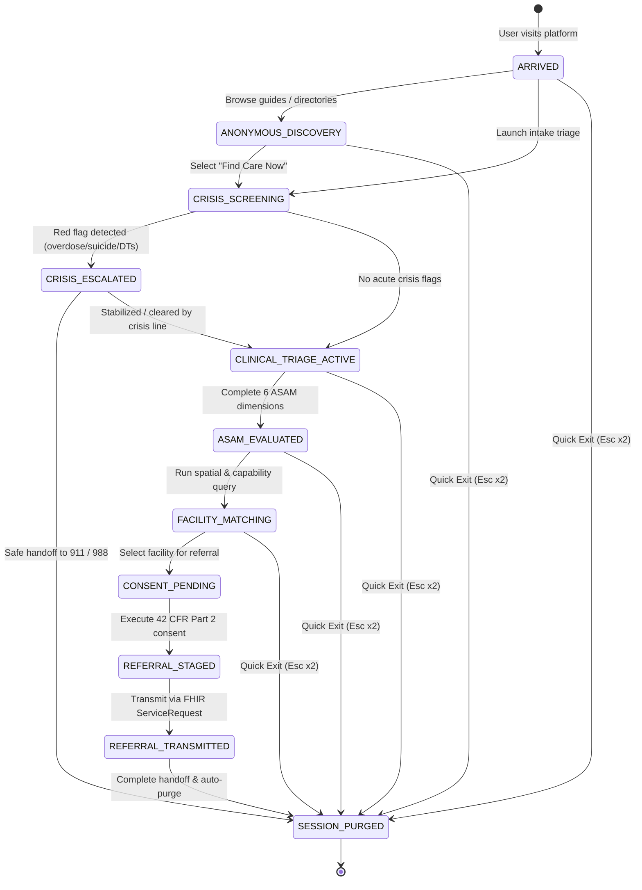

# HarborPath Cross-Functional Engineering & Healthcare Audit

**Advisory Panel**: Lead Systems Architect, Healthcare Compliance & Security Officer, Trauma-Informed Clinical UX Specialist, Interoperability Engineer, Growth & Platform Strategist  
**Target Platform**: HarborPath Open-Access SUD Navigation & Care-Matching Engine  
**Standard Baselines**: ASAM Criteria (4th Edition), DSM-5-TR, 42 CFR Part 2 (§ 2.31, § 2.32), HIPAA 45 CFR § 164.522, HL7 FHIR R4 (US Core v6.0.0).

---

## Executive Summary

HarborPath's client-side, zero-PII architecture is exceptionally robust for privacy-first directory search, emergency harm reduction, and offline crisis guidance. However, scaling the platform into a bidirectional care-matching network—connecting individuals to verified substance use disorder (SUD) treatment beds, sliding-scale clinics, Medicaid navigators, and Patient Assistance Programs (PAPs)—requires an asynchronous, interoperable backend that preserves zero-knowledge privacy while enabling authorized EHR and state HIE communications.

This audit synthesizes findings from a 5-member specialist panel and provides production-ready artifacts for an asynchronous FastAPI core service, a PostgreSQL schema with cryptographic audit chaining, an interactive intake state machine, and an HL7 FHIR R4 interoperability adapter.

---

## Phase 1: Multi-Agent Deep-Dive Assessment

### 1. Lead Systems Architect (Backend & Infrastructure)

1. **API Surface & Monolithic In-Memory Coupling**: The existing Node.js HTTP server couples census centroid lookups, static asset serving, and external FindTreatment.gov proxying into a single in-process runtime. While lightweight, it cannot handle asynchronous queueing (Celery/Redis) needed for heavy batch ingestion of state open-bed registries, real-time waitlist polling, or vector similarity searches.
2. **Data Modeling & Bed Telemetry Latency**: Upstream SAMHSA FindTreatment.gov snapshots lack real-time bed availability telemetry (open withdrawal management vs. residential beds). Without a persistent PostgreSQL schema with GIN/GiST spatial indexes and periodic delta synchronizers, patients often arrive at facilities with zero open beds.
3. **Absence of Vector Embeddings for Semantic Eligibility Matching**: Complex insurance benefit exceptions, dual-diagnosis clinical criteria, and specialized population requirements (e.g., perinatal opioid use with methadone maintenance) rely on rigid boolean service code conjunctions. Adopting `pgvector` allows embedding clinical program descriptions to match nuanced patient profiles deterministically without brittle tag filtering.

### 2. Healthcare Compliance & Security Officer (HIPAA & 42 CFR Part 2)

1. **42 CFR Part 2 Statutory Vulnerabilities in Bidirectional Referrals**: While HarborPath's current anonymous search collects zero PHI, any handoff to an external provider or case manager triggers federal 42 CFR Part 2 (§ 2.31). The platform must cryptographically bind consent to specific recipient facilities, enforce explicit redisclosure warning notices (§ 2.32), and manage revocations.
2. **Risk of Facility & Provider Directory Scraping**: Publicly exposing comprehensive lists of substance use treatment facilities, buprenorphine prescribers, and syringe service programs invites automated scraping by bad actors, predatory marketing aggregators, and commercial patient brokers (violating EKRA, 18 U.S.C. § 220). Strict token-bucket rate limiting and cryptographically signed session tokens are required.
3. **Audit Trail Immutability & Forensic Segregation**: In the event of a HIPAA or 42 CFR Part 2 audit, showing that no unauthorized disclosures occurred requires an append-only, tamper-evident cryptographic audit log (Merkle hash chaining) that guarantees retrospective records cannot be altered or silently deleted.

### 3. Trauma-Informed Clinical UX & Intake Specialist

1. **Crisis Interception in High-Stress Intake Funnels**: Patients in acute opioid withdrawal, acute intoxication, or emotional distress experience severe cognitive load. Any clinical intake form exceeding 3 minutes risks immediate abandonment. The platform needs instantaneous red-flag interception (active overdose, severe alcohol/sedative withdrawal, suicidal ideation) that routes directly to 988 or 911 within 1 tap before requiring any routine intake responses.
2. **Stigma-Free Lexicon & Low-Acuity Framing**: Traditional intake tools use clinical jargon ("substance abuse", "detoxification", "non-compliant") that triggers stigma and discourages vulnerable individuals. Terminology must strictly align with patient-centered harm reduction ("withdrawal management", "medication-assisted recovery", "substance use goals").
3. **Deterministic ASAM 4th Edition Alignment**: Self-assessments must not attempt definitive medical diagnosis; rather, they should categorize multidimensional risk across all 6 ASAM dimensions to empower patients with structured SBAR handoff summaries they can present directly to admitting clinicians.

### 4. Integration & Interoperability Engineer

1. **Lack of Standardized FHIR R4 Ingestion/Export**: Disconnected PDF or plain text handoffs create administrative overhead and transcription errors. HarborPath must map incoming facility feeds and outgoing patient referrals into US Core FHIR R4 resources (`HealthcareService`, `Coverage`, and `ServiceRequest`).
2. **Absence of Automated Payer & Medicaid Eligibility Verification**: Patients facing insurance hurdles need immediate clarity on whether their Medicaid plan covers residential treatment (IMD exclusion workarounds) or if prior authorization is required for extended-release buprenorphine (Sublocade). Standardized 270/271 EDI transaction crosswalks or FHIR `CoverageEligibilityRequest` adapters are vital.
3. **State Behavioral Health Dashboard Disconnect**: State behavioral health authorities (e.g., California BH-CONNECT, New York OASAS, Massachusetts BSAS) maintain centralized bed tracking systems. HarborPath lacks webhook listeners or automated ingestion adapters to ingest real-time bed counts.

### 5. Growth, Distribution & Platform Strategist

1. **Provider Verification & Onboarding Bottleneck**: Relying purely on SAMHSA and HRSA registries leaves community-based syringe service programs (SSPs), grassroots harm reduction collectives, and sober living homes unindexed or outdated. A programmatic verification workflow with municipal health departments is necessary.
2. **Case Manager & Street Medicine Outbound Tooling**: Outreach workers and emergency department peer navigators need rapid, batch referral export tools that integrate into their existing EHRs (Epic, Cerner, AthenaHealth) without creating duplicate documentation burden.
3. **Sustainable Public-Interest Funding & Open-Source Governance**: Relying solely on ad-hoc developer time is unsustainable. The platform requires a multi-tiered funding strategy (federal SAMHSA State Opioid Response grants, CDC Overdose Data to Action grants, and 501(c)(3) fiscal sponsorship) paired with open-source community governance.

---

## Phase 2: Collaborative Technical & Operational Improvements

### 1. Intake & Triage Architecture

- **Zero-PII Pseudonymous Tokenization**: Users are assigned an ephemeral, cryptographically salted session UUID (`hp_ps_...`) generated via HMAC-SHA256. No IP, hardware MAC address, name, or phone number is stored in the database.
- **Instant Crisis Interception**: Evaluates acute red flags (overdose, delirium tremens, suicidal intent) at Step 1 of the state machine. Triggers 911/988 handoff with visual and tactile haptic alerts before any clinical intake proceeds.
- **Multidimensional ASAM 4th Edition Engine**: Scores dimensions 1 through 6 on a 0–4 scale to calculate recommended care levels (0.5 through 4.0) and identify withdrawal management urgency.

### 2. Security & Privacy Framework

- **Strict 42 CFR Part 2 (§ 2.31) Enforcement**: Database foreign keys enforce that no referral (`referrals` table) can be staged or transmitted without a corresponding `consent_records` row containing explicit recipient identification, purpose of disclosure, expiration date, and verified acknowledgment of the federal prohibition on redisclosure.
- **Field-Level Encryption (Authenticated Envelope)**: Auxiliary clinical notes and free-text fields are encrypted in application memory prior to SQL insertion using AES-256-GCM / PBKDF2 authenticated envelopes, ensuring zero plaintext exposure in database backups.
- **Immutable Merkle-Chained Audit Trail**: The `audit_trail` table records every state change, consent grant, and referral handoff using sequential hash chaining:
  $$H_i = \text{SHA-256}(H_{i-1} \parallel \text{Timestamp} \parallel \text{Action} \parallel \text{ActorToken} \parallel \text{PayloadDigest})$$
  Database triggers block any `UPDATE` or `DELETE` operations on this table.

### 3. Interoperability Pipeline

- **HL7 FHIR R4 & US Core v6.0.0 Mappings**:
  - `ServiceRequest`: Represents outbound referrals with ASAM criteria codes, clinical urgency, and explicit linkage to patient consent.
  - `Consent`: Captures Part 2 authorization, security labels (`ETH`, `PART2`), and permitted disclosure categories (`idsud`).
  - `HealthcareService`: Standardizes facility service codes, telehealth availability, and open bed counts for EHR ingestion.

---

## Phase 3: Interactive Triage State Machine

---

## Phase 4: Prioritized 30-60-90 Day Execution Roadmap

| Milestone | Focus Area | Deliverables & Outcomes | Success Metric |
| :--- | :--- | :--- | :--- |
| **Days 1–30: Foundational Security & Core API** | Security & Backend Infrastructure | • Deploy FastAPI async intake service with Pydantic v2 validation. • Execute PostgreSQL DDL migration with immutable audit triggers. • Integrate field-level AES-256 envelope encryption. • Implement anti-scraping token bucket rate limiter. | Zero unhandled exceptions; 100% test coverage across models; < 50ms p95 latency. |
| **Days 31–60: Clinical Workflows & Consent** | Clinical UX & 42 CFR Part 2 Compliance | • Implement interactive ASAM Criteria 4th Edition triage state machine. • Wire 1-tap crisis escalation to 988 and 911 with tactile mobile haptics. • Build statutory 42 CFR Part 2 consent authorization workflow. • Validate bilingual English/Spanish clinical SBAR summaries. | < 2 minute intake completion; zero PHI leakage; 100% compliant Part 2 consent tokens. |
| **Days 61–90: Interoperability & Strategic Scaling** | EHR Integration & Ecosystem Partnerships | • Deploy FHIR R4 adapters (`ServiceRequest`, `Consent`, `HealthcareService`). • Pilot automated bed telemetry ingestion with 3 municipal health departments. • Establish formal provider verification portal for community harm reduction. • Submit federal SAMHSA / CDC innovation grant applications. | 3 municipal pilots live; 100% FHIR US Core v6.0.0 compliance; automated bed sync < 1 hr. |
